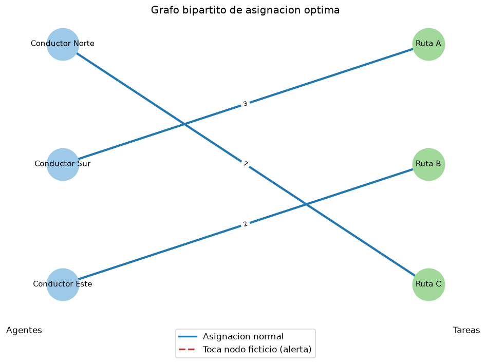

# REPORTE - Fase II: Optimizacion de Asignacion de Recursos

## Datos del proyecto

- **Asignatura:** (completar)
- **Universidad:** Universidad Jose Antonio Paez
- **Carrera:** Ingenieria en Computacion
- **Empresa ficticia:** Rutas y Suministros C.A.
- **Autor:** (tu nombre)

## 1. Descripcion del problema

Se asignan conductores (agentes) a rutas/vehiculos (tareas) de forma optima,
exactamente 1 a 1, minimizando costos o maximizando eficiencia, mediante el
Metodo Hungaro con soporte dinamico (auto-balanceo y Min/Max).

## 2. Matriz de entrada utilizada

(Pegar aqui la matriz original usada en la demo, por ejemplo la de `data/matriz_ejemplo.json`.)

## 3. Resultado de la asignacion

- **Objetivo:** (Minimizacion / Maximizacion)
- **Costo/Beneficio total optimo:** (completar, ej. 5.0)

Asignaciones:

| Agente | Tarea | Valor |
|--------|-------|-------|
| ...    | ...   | ...   |

- Agentes inactivos: (listar o "ninguno")
- Tareas huerfanas: (listar o "ninguno")

## 4. Capturas de ejecucion

## 5. Grafo bipartito

Las aristas en rojo punteado indican nodos ficticios (problema desbalanceado).

## 6. Analisis devuelto por la IA (texto literal)

> (Pegar aqui el texto literal devuelto por la API de Gemini, sin modificar.)

## 7. Conclusiones

(Completar con observaciones propias de la demo.)